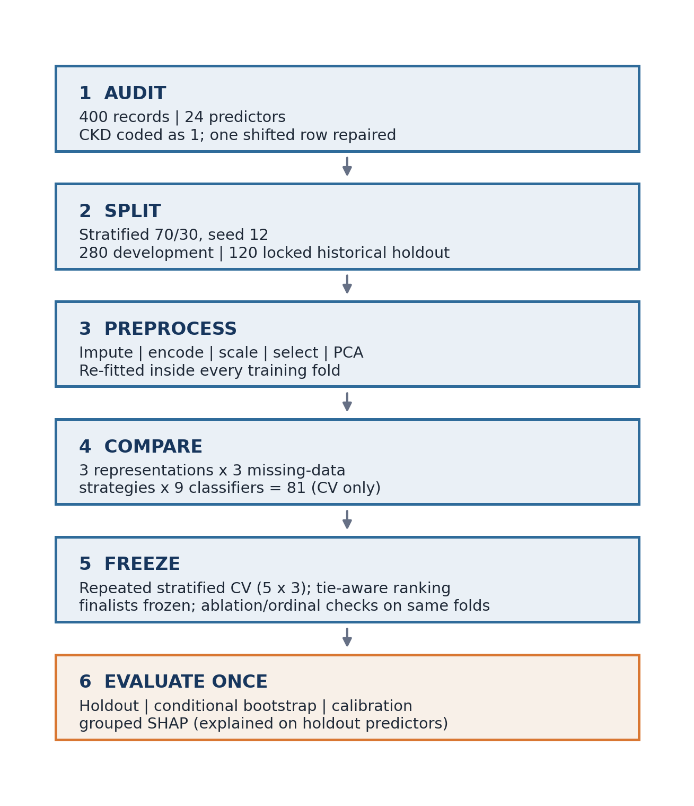
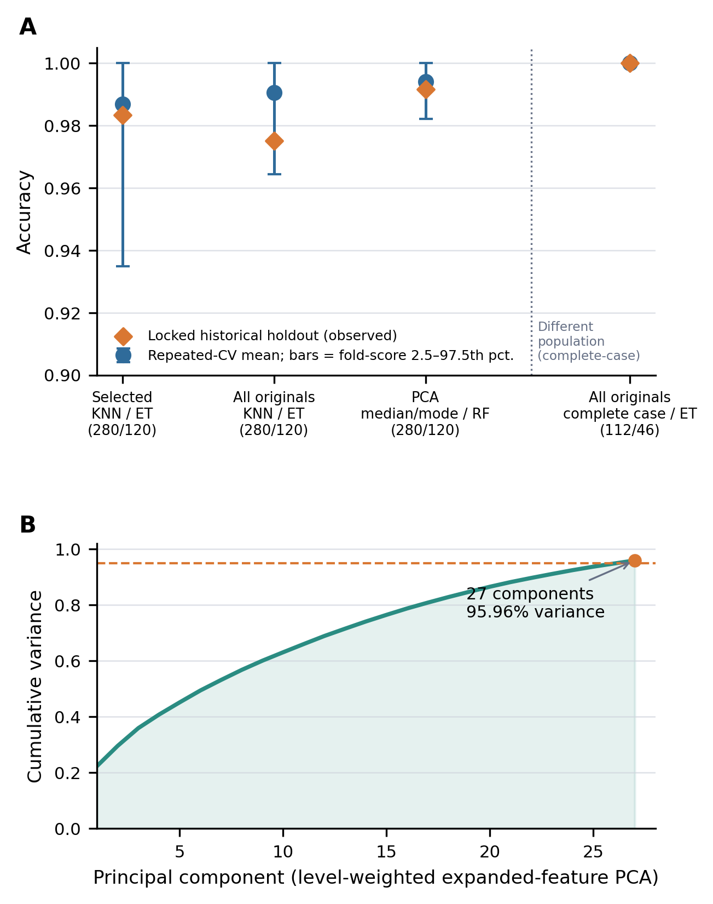
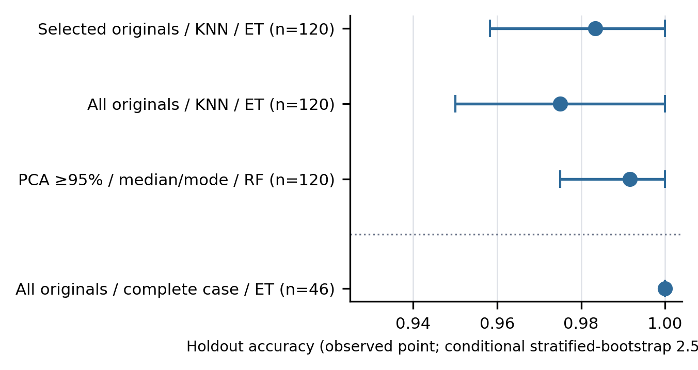
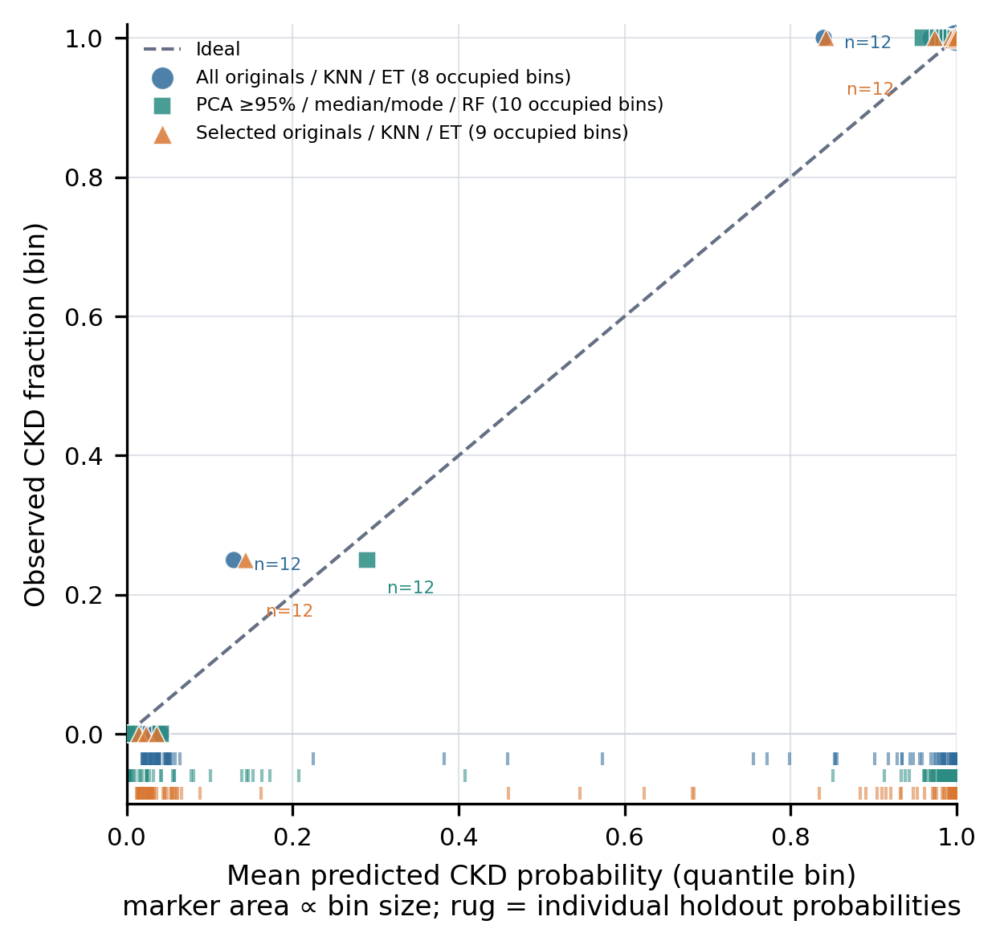
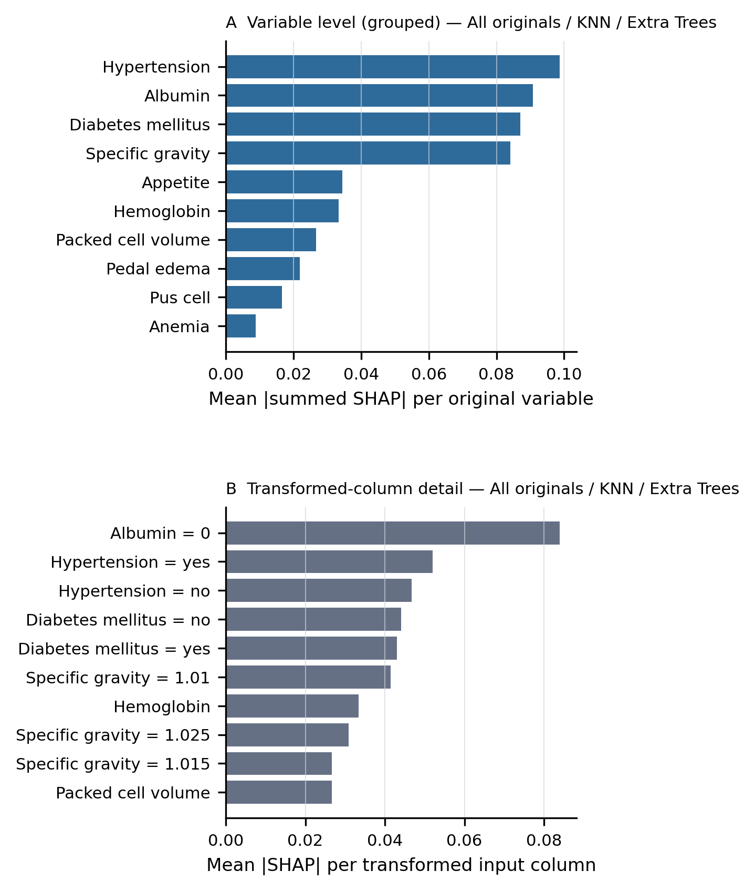
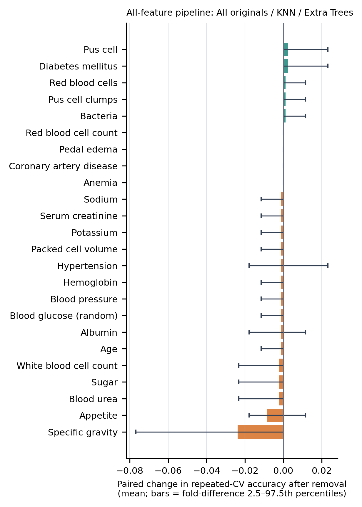

# Reproducibility and Leakage-Controlled Evaluation of Machine-Learning Models for Chronic Kidney Disease Classification

**Lening Yang, Yichuan Zhao**

Georgia State University, Atlanta, Georgia, USA

## Abstract

**Background:** Machine-learning studies based on small clinical datasets can report near-perfect classification, although apparent performance may be sensitive to preprocessing, data leakage, missing-data handling, and the choice of evaluation sample. We reproduced a published chronic kidney disease (CKD) classification study and extended its evaluation using explicit information boundaries, repeated cross-validation, calibration assessment, and model interpretation.

**Methods:** The public UCI CKD dataset contains 400 records, 24 predictors, and a binary diagnostic label. Strings, variable types, class labels, missing-value markers, and column alignment were audited before analysis. CKD was encoded as 1 and non-CKD as 0. A stratified 70:30 development–holdout partition was created with random seed 12 before any learned preprocessing; because the same public holdout labels had been visible during earlier development, the holdout was treated as a locked historical internal sample rather than as confirmatory validation. Imputation, one-hot encoding, scaling, supervised feature selection, and principal component analysis (PCA) were fitted exclusively within development-set training folds. Two cross-validation designs were used: the comparison with the published XGBoost results used a single five-fold stratified cross-validation, whereas the main comparison of nine classifiers across three feature representations and three missing-data strategies used five-fold stratified cross-validation repeated three times. Models were ranked by training cross-validation only, with exact ties reported as jointly top-ranked. A frozen set of finalists was evaluated once on the holdout for discrimination, calibration, Brier score, and conditional stratified-bootstrap percentile intervals. Leave-one-feature-out ablation, an ordinal-encoding sensitivity analysis, and SHAP values grouped by original variable were used to examine model behavior. The partition, cross-validation, selection, and holdout evaluation were additionally replicated from scratch under three further random seeds (42, 39, and 55) to examine the dependence of the selected pipelines on the random partition.

**Results:** The audit retained 250 CKD and 150 non-CKD records and repaired one shifted row. Among approaches retaining all records, the pipeline combining selected original features, numeric k-nearest-neighbor imputation, and Extra Trees was the display representative of the top-ranked selected-feature configuration, with repeated-cross-validation accuracy of 0.9869 (standard deviation, 0.0218), ROC area of 1.0000, and holdout accuracy of 0.9833. The lowest holdout Brier score among the representative retained-sample models was 0.0053 (the PCA Random Forest pipeline). PCA retained 27 components explaining 95.96% of variance and exceeded the best original-feature representation. Complete-case deletion reduced the development and holdout samples to 112 and 46 records and reversed the majority class; 8 configurations tied at the top of that branch, and its display representative achieved holdout accuracy of 1.0000 (conditional bootstrap interval, 1.0000–1.0000). Specific gravity produced the largest mean paired ablation loss (−0.0238), although the removal of no single field could be distinguished from fold-to-fold variation; hypertension had the largest grouped SHAP contribution. Under the three additional seeds, the selected-feature pipeline of the main analysis remained jointly top-ranked in two replications.

**Conclusions:** High internal performance persisted after leakage controls. PCA offered at most a marginal cross-validation difference relative to interpretable original-feature representations (0.0036 in accuracy), which lay within fold-to-fold variation and did not translate into a consistent holdout advantage across random seeds, and several distinct pipelines were statistically indistinguishable. Near-perfect estimates from this small, single-source dataset do not constitute clinical validation. External and prospective evaluation is required before clinical use.

**Keywords:** chronic kidney disease; machine learning; reproducibility; data leakage; missing data; principal component analysis; SHAP; calibration

## 1. Introduction

Chronic kidney disease (CKD) contributes substantially to global morbidity and mortality, and its health burden has increased over recent decades [1]. Contemporary clinical guidance emphasizes evaluation using measures of kidney function and kidney damage, followed by risk-based monitoring and management [2]. Computational prediction may help organize multidimensional clinical information, but the apparent performance of a model depends as much on study design and validation as on the learning algorithm itself.

Islam et al. evaluated multiple machine-learning algorithms using the UCI CKD dataset and reported high test accuracy, including approximately 0.983 for XGBoost on the original data and 0.9916 for XGBoost in an analysis described as PCA based [3]. These findings are of interest because the dataset is accessible and widely used for teaching and benchmarking. They are also difficult to reproduce exactly. The report considers several missing-data procedures, its presentation of PCA includes named original variables, and not all implementation details required for exact replication are available. Such ambiguities matter because fitting transformations to all records before resampling can transfer information from validation observations into model training, thereby inflating performance estimates [5].

Prediction-model reporting and risk-of-bias frameworks emphasize transparent data flow, appropriate missing-data handling, separation of model development from evaluation, and reporting of both discrimination and calibration [6,7]. Small datasets create additional challenges: performance can be strongly influenced by a favorable partition, observations recur across repeated cross-validation fits, exact ties between pipelines are common, and uncertainty may remain substantial even when average accuracy is high [8,9]. A rigorous reproduction should therefore document the source data, distinguish deterministic cleaning from learned preprocessing, quantify uncertainty, report ties rather than nominal winners, and avoid interpreting internal validation as evidence of clinical transportability.

This study had three objectives. First, we reproduced the published comparison using the public UCI CKD dataset while auditing the source schema and enforcing training-only estimation of all learned preprocessing. Second, we compared three feature representations—all original predictors, PCA of the expanded encoded matrix, and supervised selection of named clinical fields—and three approaches to missing data. Third, we extended the evaluation with repeated stratified cross-validation, tie-aware model selection, a single frozen evaluation of a locked historical holdout with conditional bootstrap intervals, calibration, Brier score, paired leave-one-feature-out ablation, an ordinal-encoding sensitivity analysis, and SHAP interpretation grouped by original variable. The aim was not to tune the analysis toward the published 99.16% result, but to determine whether high performance persisted under a transparent, leakage-controlled design.

## 2. Materials and Methods

### 2.1 Study design

This secondary computational study reproduced and methodologically evaluated a published analysis of an existing public dataset. The design was informed by TRIPOD+AI reporting principles and PROBAST+AI risk-of-bias domains [6,7]. It was not a prospective diagnostic trial, clinical-impact study, or external validation. Figure 1 summarizes the analytical sequence and the separation between model development, the freezing of finalists, and holdout evaluation.

*Figure 1. Leakage-controlled analytical workflow. The holdout sample was separated before learned preprocessing or model selection. Imputation, encoding, scaling, feature selection, and PCA were re-estimated within each cross-validation training fold; finalists were frozen from training cross-validation before the holdout was evaluated once.*

### 2.2 Data source, predictors, and outcome

The Chronic Kidney Disease dataset was obtained from the UCI Machine Learning Repository [4]. The source file contained 400 rows, 24 predictor fields, one outcome field, and one additional spreadsheet column. Following the UCI metadata, 11 predictors were treated as numeric: age, blood pressure, random blood glucose, blood urea, serum creatinine, sodium, potassium, hemoglobin, packed cell volume, white blood cell count, and red blood cell count. Thirteen predictors were treated as categorical: specific gravity, albumin, sugar, red blood cells, pus cell, pus cell clumps, bacteria, hypertension, diabetes mellitus, coronary artery disease, appetite, pedal edema, and anemia. Specific gravity, albumin, and sugar were retained as nominal categorical variables in the main analysis because the repository metadata defines them as nominal levels; because these three fields are clinically graded, a prespecified ordinal-encoding sensitivity analysis is described in Section 2.11.

The outcome was normalized after case folding and removal of spaces, tabs, underscores, and hyphens. Labels corresponding to “ckd” were mapped to CKD = 1; labels corresponding to “notckd” or “nonckd” were mapped to non-CKD = 0. Outcome values were not inferred from predictor measurements.

### 2.3 Data audit and deterministic cleaning

Column names and string cells were Unicode normalized, converted to lower case, and stripped of leading and trailing whitespace. Repeated internal whitespace was collapsed. Empty values, question marks, repeated question marks, “NA,” “N/A,” “none,” “null,” and “missing” were converted to missing values. Numeric fields were coerced to numeric type, and categorical values were checked against prespecified allowed levels. Unrecognized levels were treated as missing.

One record was shifted by one column from the diabetes field onward, placing a valid “notckd” label in the additional column. The row was repaired using a deterministic rule that required an invalid label in the nominal target position and a valid label in the overflow position. The additional column was then removed. No invalid category or outcome value remained after cleaning, leaving 400 rows and 25 analytical columns, including the outcome.

### 2.4 Development and holdout samples

Before imputation, encoding, scaling, PCA, or supervised selection, the data were divided into a development sample (70%, n = 280) and a holdout sample (30%, n = 120) by stratified random sampling with seed 12. The development sample contained 175 CKD and 105 non-CKD records; the holdout sample contained 75 CKD and 45 non-CKD records. The same partition was used throughout all analyses and its row assignments were persisted.

The holdout labels of this public dataset had been visible during earlier development of the same analysis. The holdout is therefore described as a locked historical internal holdout: it was excluded from every fitting, ranking, and selection step of the corrected analysis, but it cannot be presented as a new confirmatory or external sample.

All learned transformations were incorporated into the modeling pipeline and re-estimated separately in every cross-validation training fold. Consequently, imputation values, category vocabularies, scaling parameters, principal axes, and supervised feature scores were not informed by validation-fold or holdout observations. Table 1 summarizes the experimental comparisons and information boundaries.

### 2.5 Missing-data strategies

Three prespecified strategies were compared. In the median/mode strategy, numeric predictors were imputed with the training-fold median and categorical predictors with the most frequent training-fold category. In the k-nearest-neighbor strategy, numeric predictors were first standardized with training-fold means and standard deviations and then imputed with a distance-weighted five-neighbor method, so that neighbor distances were comparable across variables whose raw scales differ by several orders of magnitude (for example, white blood cell count and serum creatinine); categorical predictors remained mode imputed so that arbitrary distances were not imposed between nominal levels. In the complete-case strategy, rows with any missing predictor were deleted separately from the development and holdout samples after the initial split, and no imputer was applied afterwards. Complete-case deletion does not estimate imputation parameters, but it can alter the outcome and covariate distributions when missingness is informative. It was therefore treated as a sensitivity analysis in a different analytical population rather than as the primary approach.

### 2.6 Feature representations

Three representations were evaluated. The first used all 24 original clinical fields, with numeric scaling after imputation (or before k-nearest-neighbor imputation, as above) and one-hot encoding of categorical variables. The second performed PCA after imputation, full one-hot encoding, and standardization of the complete encoded matrix; the smallest number of components reaching at least 95% cumulative explained variance was selected within each training fit [10]. Because every expanded one-hot level receives unit variance, this is a level-weighted PCA of the expanded feature matrix rather than an equal weighting of the 24 clinical variables. The third used supervised mutual information, estimated only from the relevant training fold, to retain eight of the 24 named clinical fields. For calculation of selection scores, missing values were temporarily filled inside the training fold with the same strategy as the downstream pipeline (median or scaled k-nearest-neighbor imputation for numeric fields and mode imputation for categorical fields; complete-case selection rejected missing values); the selector then passed the original selected columns to the pipeline, where preprocessing was re-estimated. For the k-nearest-neighbor strategy, selection scores used all candidate numeric variables for neighbor distances and are therefore a training-only screening approximation of the later selected-panel imputation.

When fitted to the full development sample, the selected-feature display representative retained serum creatinine, sodium, hemoglobin, packed cell volume, red blood cell count, specific gravity, albumin, and hypertension. Because selection was repeated in each cross-validation fold, the field set could vary across validation iterations.

PCA and original-feature selection were considered distinct operations. PCA is an unsupervised rotation into linear combinations that maximize predictor variance, whereas mutual-information selection uses the training outcome and preserves clinically named measurements. Their performance and interpretability were therefore assessed separately.

### 2.7 Classifiers

Nine classifiers were prespecified: logistic regression, decision tree, Random Forest [11], support-vector machine (SVM), k-nearest neighbors, AdaBoost, gradient boosting, Extra Trees [12], and XGBoost [13]. Fixed configurations were used, and the holdout sample was not used for hyperparameter selection. Logistic regression used the liblinear solver with a maximum of 5,000 iterations. The decision tree had maximum depth 6 and minimum leaf size 2. Random Forest and Extra Trees each used 300 estimators, minimum leaf size 2, and balanced class weights; the other seven classifiers used their model-specific defaults without class weighting, so the nine-model comparison combines algorithm choice with model-specific handling of class imbalance rather than holding imbalance handling constant. The radial-basis-function SVM used C = 2 and probability estimation. The k-nearest-neighbor classifier used five distance-weighted neighbors. AdaBoost used 200 estimators and learning rate 0.05. Gradient boosting used 200 estimators, learning rate 0.05, and maximum depth 2. XGBoost used 200 estimators, maximum depth 3, learning rate 0.05, row and column subsampling of 0.9, and L2 regularization of 1. Random seed 12 was used wherever supported.

### 2.8 Cross-validation and model selection

The combination of three missing-data strategies, three representations, and nine classifiers produced 81 prespecified analyses. Evaluation in the development sample used five-fold repeated stratified cross-validation with three repeats and random seed 12, yielding 15 validation-fold scores per combination; the row assignments of every repeat and fold were persisted, separately for the full development sample and for its complete-case subset. Complete preprocessing pipelines, rather than previously transformed matrices, were submitted to cross-validation. The comparison table contained training cross-validation metrics only.

Models were ranked by mean ROC area, then mean F1 score, and then mean accuracy, each rounded to 12 decimal places. Configurations with identical rounded values were treated as exactly tied and reported as jointly top-ranked with their tie count; no tied configuration was called the unique best. Where a single pipeline was needed for a figure or a downstream diagnostic, one member of the tied set was chosen by a documented lexicographic order of scenario, imputation, and model name and labelled the display representative. This label denotes a technical choice, not statistical superiority. Complete-case and imputed analyses were ranked and interpreted separately because they represented different analytical populations.

For each metric, the mean and sample standard deviation across the 15 validation folds were calculated. The reported fold-score range is the empirical 2.5th–97.5th percentile range of these scores. Because validation folds overlap across repeats, this range describes score stability and is not a confidence interval for performance in an independent population [8,9].

### 2.9 Holdout evaluation and bootstrap analysis

After both cross-validation rankings were frozen, a prespecified finalist set was fitted once to its complete development branch and evaluated once on the corresponding holdout branch: the display representative of each feature representation among strategies retaining all records, the complete-case display representative, the display representative among non-PCA tree models retaining all records (used for SHAP), and the median/mode XGBoost pipelines with all original features and with PCA, which were needed for the comparison with the published study. No other pipeline was evaluated on the holdout, and holdout results were never used for ranking. Accuracy, positive predictive value, sensitivity, specificity, F1 score, ROC area, precision-recall area, and Brier score were calculated. Precision-recall area was implemented as average precision, and specificity was defined as TN/(TN + FP).

Holdout uncertainty was summarized using 1,000 stratified bootstrap resamples that preserved the observed numbers of CKD and non-CKD records. Percentile intervals were obtained from predictions of the already fitted model; the model was not retrained within bootstrap samples. The intervals are therefore conditional stratified-bootstrap percentile intervals: they condition on the chosen model, the fixed partition, and the observed class counts, represent sampling variation among the observed holdout records, and do not capture uncertainty arising from model development or selection. The observed holdout metric, not the bootstrap mean, is the point estimate, and an interval that collapses to a single value after perfect classification does not indicate absence of uncertainty.

### 2.10 Calibration

Calibration was assessed for the cross-validation-selected display representative of each feature representation among strategies retaining all holdout observations. Two separate binnings were used. Calibration curves used ten quantile-based bins of the predicted probabilities; because many predicted probabilities were tied near 0 or 1, fewer than ten bins could be occupied, and the number of occupied bins, their sample sizes, and the individual predicted probabilities are shown in the figure. Bins were not connected by lines because no calibration was observed between them. The Brier score was calculated as the mean squared difference between predicted CKD probability and the binary outcome, with lower values indicating better probability accuracy [15]. A ten-bin expected calibration error (ECE) was computed separately with equal-width bins on [0, 1] as the weighted mean absolute difference between observed and predicted risk across bins, retaining empty bins with zero weight. Because of the limited holdout size, ECE was treated as descriptive.

### 2.11 Ablation, ordinal-encoding sensitivity, and SHAP analyses

Leave-one-feature-out ablation was performed for the all-original-feature representation using its own cross-validation display representative among analyses retaining all records (model family and missing-data strategy frozen from the selection manifest before any holdout evaluation). Each field was removed in turn, and the complete pipeline was reevaluated on the identical 15 persisted validation folds. Paired differences in accuracy relative to the all-feature pipeline were computed fold by fold and summarized by their mean and their 2.5th–97.5th percentiles across folds; because folds overlap, these percentiles are descriptive and tend to be narrow. All 24 fields are reported without truncation (Supplementary Figure S1). The ablation pipeline (Extra Trees with numeric k-nearest-neighbor imputation on all original fields) is refitted within every fold, whereas SHAP interprets a single development-sample fit of the all originals / KNN / Extra Trees model.

In the ordinal-encoding sensitivity analysis, the all-original-feature display representative (the pipeline used for ablation) was refitted on the same 15 folds with specific gravity, albumin, and sugar coded as ordered integers using their prespecified clinical levels (1.005–1.025 and 0–5), after within-fold mode imputation, while all other categorical fields remained nominal. Integer coding assumes equal spacing for linear and distance-based models and imposes an order constraint for tree models. Paired fold differences relative to the nominal encoding were summarized as above. The result was not used to change any selection.

SHAP analysis was applied to the cross-validation-selected, non-PCA tree model among approaches retaining all records, fitted on the development sample and explained on the holdout predictors [14]. Because one-hot encoding splits each categorical field into several model inputs, and the two levels of a binary field are exactly complementary, importance was summarized at the level of the original clinical variable: for every observation, the signed SHAP contributions of all model inputs derived from the same original variable were summed, and the mean absolute value of that grouped contribution was reported. Transformed-column values were retained as supplemental detail. SHAP magnitude was not interpreted as a causal effect or as evidence that a measurement is clinically necessary, and with k-nearest-neighbor imputation a raw variable can also influence the imputed values of other variables.

### 2.12 Software environment

Analyses were conducted in Python 3.9.6 with NumPy 2.0.2, pandas 2.3.3, SciPy 1.13.1, scikit-learn 1.6.1 [16], XGBoost 2.1.4, SHAP 0.49.1, Matplotlib 3.9.4, Seaborn, and OpenPyXL; exact versions of every package are recorded in the run manifest and in a lock file distributed with the code. Random seed 12 was used for all stochastic procedures unless otherwise specified. The complete pipeline, including every figure and every numeric value in this article, is regenerated by the released scripts from persisted machine-readable results; no performance value was entered by hand.

### 2.13 Seed-sensitivity analysis

Because the development–holdout partition, the cross-validation folds, the bootstrap resamples, and the stochastic classifiers all depend on one random seed, the main analysis (seed 12) was replicated from scratch under three further prespecified seeds (42, 39, and 55). For each replication the stratified 70:30 partition was redrawn, the population-specific repeated cross-validation registries were regenerated, all 81 combinations were re-evaluated, the tie-aware selection rule was reapplied, and each frozen finalist was fitted once on that replication's development sample and evaluated once on that replication's holdout sample. No bootstrap intervals were computed in the replications. The replications began only after the main selection manifest had been frozen, could not influence it, and are reported as descriptive evidence of the stability of the selection rule rather than as additional validation; the holdout samples of different seeds overlap and are not independent.

### Table 1. Experimental comparisons and safeguards against data leakage

| Component | Specification | Information boundary |
|---|---|---|
| Development–holdout split | Stratified 70:30 partition; seed 12; row assignments persisted | Completed before learned preprocessing; holdout is a locked historical internal sample |
| Missing data | Median/mode; standardization followed by numeric five-neighbor imputation with categorical mode; complete-case deletion | Imputation and scaling fitted within training folds; deletion applied separately to each partition |
| Feature representation | All 24 fields; level-weighted PCA of the expanded encoded matrix to ≥95% variance; mutual-information selection of eight named fields | Encoding, scaling, PCA, and selection fitted within training folds |
| Classifiers | Nine fixed algorithms; 81 total combinations | Holdout outcomes excluded from fitting and ranking |
| Internal validation | Five folds × three repeats on persisted folds; ranking by ROC area, F1, then accuracy with exact ties reported | Development sample only; no holdout column in the comparison table |
| Holdout evaluation | Frozen finalists evaluated once; discrimination, calibration, Brier score, and 1,000 stratified bootstrap resamples | Conditional evaluation of fixed fitted models after all rankings were frozen |

## 3. Results

### 3.1 Dataset composition and missingness

The analytical dataset included 250 CKD records (62.5%) and 150 non-CKD records (37.5%). Missingness varied substantially across predictors (Table 2). red blood-cell morphology (152/400, 38.0%) had the most missing observations, followed by red blood cell count (131/400, 32.8%), white blood cell count (106/400, 26.5%), potassium (88/400, 22.0%), and sodium (87/400, 21.8%). Complete-case deletion retained 158 of 400 records (39.5%), of which 115 (72.8%) were non-CKD and 43 (17.2% of all CKD records) were CKD. When applied separately to the fixed partitions, it retained 112 development records (81 non-CKD and 31 CKD) and 46 holdout records, compared with 280 and 120 under imputation. Complete-case deletion therefore not only reduced the sample but reversed the majority class: CKD fell from 62.5% of the full development sample to 27.7% of the complete-case development sample, so accuracy, precision, precision-recall area, and Brier score are not comparable across the two populations.

### Table 2. Predictor groups and missingness in the analytical dataset (N = 400)

| Predictor group | Variables | Missing observations, n (%) |
|---|---|---|
| Demographic and vital signs | Age; blood pressure | 9 (2.3%); 12 (3.0%) |
| Metabolic and renal laboratory measures | Random blood glucose; blood urea; serum creatinine; sodium; potassium | 44 (11.0%); 19 (4.8%); 17 (4.3%); 87 (21.8%); 88 (22.0%) |
| Hematologic measures | Hemoglobin; packed cell volume; white blood cell count; red blood cell count | 52 (13.0%); 71 (17.8%); 106 (26.5%); 131 (32.8%) |
| Urinalysis | Specific gravity; albumin; sugar; red blood cells; pus cell; pus cell clumps; bacteria | 47 (11.8%); 46 (11.5%); 49 (12.3%); 152 (38.0%); 65 (16.3%); 4 (1.0%); 4 (1.0%) |
| Clinical history and examination | Hypertension; diabetes mellitus; coronary artery disease; appetite; pedal edema; anemia | 2 (0.5%); 2 (0.5%); 2 (0.5%); 1 (0.3%); 1 (0.3%); 1 (0.3%) |

### 3.2 Reproduction of the published comparison

The source study reported XGBoost accuracy of approximately 0.983 using original data and 0.9916 using its PCA-labelled data [3]. In the present leakage-controlled reproduction with median/mode imputation and a single five-fold stratified cross-validation of the development sample, XGBoost achieved mean development accuracy of 0.968 with the original representation and 0.986 with PCA; on the locked holdout, these two prespecified pipelines achieved accuracy of 1.000 and 1.000, respectively. PCA therefore increased the development cross-validation accuracy of XGBoost but did not change its holdout accuracy, and in the full repeated-cross-validation comparison (Section 3.5) the PCA display representative exceeded the best original-feature representative (difference in accuracy, 0.0036), a difference smaller than the fold-to-fold standard deviation of either pipeline. High overall classification performance was therefore broadly reproduced, but the published advantage of PCA was reproduced at most as a marginal, seed-dependent difference (Section 3.8). Direct numerical comparison is limited because the PCA-labelled presentation in the source article retained named clinical variables, whereas the present PCA representation consisted of standardized linear components of the expanded encoded matrix.

### 3.3 Repeated cross-validation

Across all 81 combinations, 8 configurations were exactly tied at the top of the prespecified cross-validation rule with ROC area, F1 score, and accuracy of 1.0000, 1.0000, and 1.0000, respectively; 8 of them used complete-case deletion, and 8 of the 27 complete-case configurations shared this ceiling. These ties arise because the complete-case development sample contains only 112 records and is easily separated, not from any property of a particular classifier; ranks within the tied set carry no information. The complete-case display representative, all original features, complete-case deletion, and Extra Trees, is therefore one arbitrary member of that set. Because deletion removed 60.5% of the cohort, reversed the class balance (its holdout subset contained 34 non-CKD and 12 CKD records), and produced perfect validation scores for many classifiers, the complete-case branch was interpreted as a sensitivity analysis rather than the primary result.

Among approaches retaining all records, the top rank of the selected-original-feature representation was held by a single configuration, with display representative selected original features, numeric k-nearest-neighbor imputation, and Extra Trees; the top-tie counts of the all-original and PCA representations were 1 and 1. The selected-feature representative's repeated-cross-validation accuracy was 0.9869 ± 0.0218, with a fold-score range of 0.9348–1.0000; mean sensitivity was 0.9829, specificity 0.9937, F1 score 0.9892, ROC area 1.0000, and precision-recall area 1.0000. The all-original-feature representative, all original features, numeric k-nearest-neighbor imputation, and Extra Trees, achieved accuracy of 0.9905 ± 0.0133, and the PCA representative, PCA, median/mode imputation, and Random Forest, achieved 0.9940 ± 0.0087 (Table 3); the complete-case sensitivity result is reported separately in Table 4. Figure 2 compares repeated-cross-validation and holdout accuracy for the four display representatives and shows the cumulative variance explained by PCA.

*Figure 2. Comparative performance and PCA dimensionality. (A) Mean repeated-cross-validation accuracy with error bars spanning the 2.5th–97.5th percentiles of the 15 validation-fold scores (bounded by 0 and 1) and observed accuracy on the locked historical holdout for the four display representatives. The complete-case result, separated by the dotted line, refers to a different analytical population (112 development and 46 holdout records) and is not population-equivalent to the imputed analyses. (B) Cumulative explained variance of the principal components fitted to the full development sample; 27 components retained at least 95% of total variance.*

### Table 3. Principal repeated-cross-validation and locked-holdout results (analyses retaining all records)

| Pipeline and sample size (development/holdout) | Repeated cross-validation | Locked historical holdout |
|---|---|---|
| Selected originals; KNN; Extra Trees (280/120) | Accuracy 0.9869 ± 0.0218 (fold-score range, 0.9348–1.0000); sensitivity/specificity 0.9829/0.9937; ROC area 1.0000 | Accuracy 0.9833 (conditional bootstrap interval, 0.9583–1.0000); ROC area 1.0000; Brier score 0.0142 |
| All originals; KNN; Extra Trees (280/120) | Accuracy 0.9905 ± 0.0133 (fold-score range, 0.9643–1.0000); sensitivity/specificity 0.9848/1.0000; ROC area 1.0000 | Accuracy 0.9750 (conditional bootstrap interval, 0.9500–1.0000); ROC area 1.0000; Brier score 0.0149 |
| PCA ≥95%; median/mode; Random Forest (280/120) | Accuracy 0.9940 ± 0.0087 (fold-score range, 0.9821–1.0000); sensitivity/specificity 0.9905/1.0000; ROC area 1.0000 | Accuracy 0.9917 (conditional bootstrap interval, 0.9750–1.0000); ROC area 1.0000; Brier score 0.0053 |

*KNN, k-nearest-neighbor imputation; PCA, principal component analysis; SVM, support-vector machine. Each row is the display representative of its representation among analyses retaining all records. Fold-score ranges are the 2.5th–97.5th percentiles of 15 overlapping validation folds and do not estimate uncertainty in an external population. Bootstrap intervals are conditional on fixed fitted models and on the observed class counts.*

### Table 4. Complete-case sensitivity analysis in a different analytical population

| Pipeline and sample size (development/holdout) | Repeated cross-validation | Locked historical holdout |
|---|---|---|
| All originals; complete case; Extra Trees (112/46); development 81 non-CKD and 31 CKD; holdout 34 non-CKD and 12 CKD | Accuracy 1.0000 ± 0.0000 (fold-score range, 1.0000–1.0000); sensitivity/specificity 1.0000/1.0000; ROC area 1.0000 | Accuracy 1.0000 (conditional bootstrap interval, 1.0000–1.0000); ROC area 1.0000; Brier score 0.0030 |

*The complete-case representative is one of 8 exactly tied configurations and was evaluated in a subset in which non-CKD is the majority class. Accuracy, precision, precision-recall area, and Brier score are prevalence dependent and are therefore not comparable with Table 3; ROC area is the only metric intended for cross-population comparison.*

### 3.4 Holdout discrimination and bootstrap intervals

The selected-feature display representative, Extra Trees, classified 118 of 120 holdout records correctly: TN = 45, FP = 0, FN = 2, and TP = 73. Its precision-recall area was 1.0000. For a pipeline that classifies every holdout record correctly, the fixed-prediction bootstrap interval collapses to a single value; such an interval would reflect perfect classification of the observed holdout records under conditional resampling and would not imply absence of uncertainty in model development or transport to new settings.

The all-feature Extra Trees classified 117 of 120 records correctly (FN = 3, FP = 0), and the PCA Random Forest classified 119 of 120 records correctly (FN = 1, FP = 0). The complete-case Extra Trees classified 46 of 46 records in its smaller holdout subset correctly (FN = 0, FP = 0). Figure 3 presents the conditional bootstrap intervals for the four display representatives.

*Figure 3. Conditional stratified-bootstrap intervals for holdout accuracy. Points indicate observed accuracy and bars indicate the 2.5th–97.5th percentiles from 1,000 class-stratified resamples of the fixed predictions. Models were not retrained during bootstrap, and the complete-case pipeline (below the dotted line) was evaluated in a different, smaller holdout population.*

### 3.5 Feature representation and missing-data sensitivity

Among analyses retaining all records, the cross-validation accuracies of the three representation-specific display representatives were closely grouped: 0.9869 for selected original fields, 0.9905 for all original fields, and 0.9940 for PCA. The PCA model fitted to the full development sample retained 27 components explaining 95.96% of the variance of the 47 standardized expanded columns. PCA therefore exceeded the best original-feature representation and used more transformed dimensions than the eight-field supervised selector, although the number of components is not directly comparable with the number of original fields because one-hot encoding expands categorical predictors.

The display representatives used numeric k-nearest-neighbor imputation for the selected-feature representation, numeric k-nearest-neighbor imputation for the all-original representation, and median/mode imputation for PCA; differences between imputation strategies were small relative to fold-to-fold variation. Complete-case analyses frequently produced perfect validation scores, but they evaluated a much smaller and differently composed subset. Their apparent performance does not demonstrate that deleting incomplete records is preferable to imputation.

### 3.6 Calibration

All three representative retained-sample models had low Brier scores on the holdout sample. The lowest Brier score, 0.0053, was observed for the PCA Random Forest pipeline; the all-original Extra Trees had Brier score 0.0149 and ECE 0.0500, the PCA Random Forest had Brier score 0.0053 and ECE 0.0325, and the selected-feature Extra Trees had Brier score 0.0142 and ECE 0.0466. Because most predicted probabilities were concentrated near 0 or 1, tied values collapsed adjacent quantile bins: the ten requested bins yielded 8, 10, and 9 occupied bins for the three models, respectively, and no calibration was observed over wide intermediate probability ranges (Figure 4). Departures from the ideal line occurred in sparsely populated bins, and the equal-width ECE values depend on how those few intermediate probabilities fall into bins. With only 120 holdout observations, small differences in Brier score or ECE should not determine model choice.

*Figure 4. Holdout calibration of the representative analyses retaining all records. Markers show quantile-based bins with the number of holdout records in each bin; bins are not connected because no calibration is observed between them, and the rug below the axis shows the individual predicted probabilities. The dashed diagonal denotes ideal calibration. Lower Brier scores indicate better probability accuracy.*

### 3.7 Ablation and SHAP findings

The all-feature pipeline used for ablation—Extra Trees with numeric k-nearest-neighbor imputation, the display representative of the all-original-feature representation—had repeated-cross-validation accuracy of 0.9905 before any field was removed. Removing specific gravity produced the largest mean paired decrease in accuracy (−0.0238; fold-difference range, −0.0768 to 0.0000). The fold-difference range included zero for 24 of the 24 fields and lay entirely below zero for 0, so the removal of no single field could be distinguished from fold-to-fold variation; the complete set of paired differences is shown in Supplementary Figure S1 without truncation.

In the all originals / KNN / Extra Trees model, the largest grouped mean absolute SHAP contribution corresponded to hypertension (0.0987), followed closely by albumin (0.0907) and then diabetes (Figure 5); the first two values were nearly identical and should not be ranked against each other. At the level of individual transformed inputs, the largest single contribution was albumin = 0 (0.0840); this level-wise ranking differs from the variable-level ranking because categorical fields are split across several inputs and the two levels of a binary field are complementary. The leading variables of the grouped SHAP ranking and of the ablation ranking differed. The two analyses quantify different aspects of model behavior—attribution within one fitted model versus retraining the same configuration without a field—and neither establishes causality.

### 3.8 Seed sensitivity

Across the three additional seeds (42, 39, and 55) and the five selection scopes—15 seed–scope pairs in total—the display representative of the main analysis remained jointly top-ranked in 6 pairs and was the identical display representative in 6 pairs; its worst dense rank in any replication was 6 (Supplementary Table S1). For the selected-feature representation that served as the primary pipeline, the main-analysis configuration remained jointly top-ranked under two of the additional seeds, and the display representatives of that scope reached repeated-cross-validation accuracy of 0.9810–0.9952 and holdout accuracy of 0.9750–0.9833 across the replications. Among all retained-sample scopes and replications, the lowest holdout accuracy of any display representative was 0.9750 and the lowest holdout ROC area was 0.9985. Where several configurations were exactly tied at the top of a scope, a change of display representative between seeds reflects the lexicographic tie-breaking rule rather than a difference in performance; where the main-analysis representative fell below the top rank, Supplementary Table S1 reports its dense rank together with the cross-validation and holdout metrics of the configuration displayed instead.

## 4. Discussion

### 4.1 Principal findings

Very high internal discrimination on the UCI CKD dataset persisted when learned preprocessing was restricted to training folds and when k-nearest-neighbor imputation was performed on standardized values. Among approaches retaining all observations, the representation-specific display representatives were nearly indistinguishable: their mean repeated-cross-validation accuracies spanned only 0.0071, ROC areas reached or approached 1.0 across multiple representations, and the complete-case branch produced a large set of exactly tied configurations. With 400 records, ranking a single method by differences in the third decimal place would overstate the precision of model comparison; the corrected analysis therefore reports ties explicitly and treats the display representatives as technical examples.

Discrimination and probability accuracy need not produce identical rankings. The lowest holdout Brier score among the representative models was observed for the PCA Random Forest pipeline, and the highest repeated-cross-validation accuracy among the retained-sample display representatives belonged to the PCA Random Forest pipeline; the two criteria coincided in this analysis. If predicted probabilities were to support clinical risk thresholds rather than binary classification alone, calibration would require independent evaluation and likely recalibration in the intended setting.

*Figure 5. Model interpretation for the all originals / KNN / Extra Trees model, fitted on the development sample and explained on the holdout predictors. (A) Mean absolute grouped SHAP contribution per original clinical variable, obtained by summing the signed contributions of all transformed inputs derived from each variable within every observation. (B) Mean absolute SHAP value per transformed input column (one-hot levels shown separately) as supplemental detail. The paired ablation analysis is shown in Supplementary Figure S1.*

### 4.2 Comparison with the published study

The findings support the broad conclusion of Islam et al. that CKD labels in this dataset are highly separable using conventional machine-learning methods [3]. They reproduced, however, only a marginal and seed-dependent difference in favor of PCA: among analyses retaining all records, the PCA display representative had the strictly highest repeated-cross-validation accuracy under three of the four seeds examined and the strictly highest holdout accuracy under one of the four seeds, and all differences were within fold-to-fold variation. The standardized PCA representation comprised 27 orthogonal components, and XGBoost holdout accuracy with PCA (1.000) was equal to that with the original representation (1.000). Differences may reflect partitioning, missing-data handling, model configuration, or the distinction between mathematical PCA and the named-variable reduction shown in the source report.

The development–holdout partition and preprocessing rules were retained irrespective of agreement with the published 99.16% estimate. Reproducibility was defined as a transparent implementation of the reported design and explicit documentation of disagreements, rather than numerical tuning toward the previously reported value.

### 4.3 Leakage control and evaluation design

The central leakage safeguard was structural: every transformation that estimated a statistic or used the outcome was fitted as part of the model within each cross-validation iteration. Median and mode values, scaling parameters, neighbor distances, category vocabularies, principal axes, and mutual-information scores were therefore derived exclusively from the relevant training fold. Holdout observations did not participate in model fitting or ranking, the comparison tables contained no holdout column, and only a frozen finalist set was evaluated on the holdout, once.

This structure reduces a common source of optimistic bias [5], but it does not convert the holdout sample into external validation. The holdout labels were visible during earlier development of this analysis, and even within the corrected design the finalist evaluations share one holdout sample, so the holdout results are conditional internal estimates rather than confirmation. Confirmatory evaluation would require freezing the complete procedure and applying it once to a new hospital, time period, or prospectively collected cohort.

### 4.4 PCA and original-feature selection

PCA and original-feature selection showed similar discrimination but differed substantially in interpretability. PCA represented variation in the expanded encoded matrix, in which every one-hot level carries unit variance, and 27 components were required to reach 95% explained variance. Each component combines multiple laboratory measurements and categorical levels and cannot generally be described as an individual clinical measurement [10]. In contrast, supervised selection retained eight named fields. This does not demonstrate that the eight fields form a universally optimal clinical panel: selection was outcome dependent, repeated within folds, and did not account for acquisition cost, fairness, or temporal availability.

The main analysis treated specific gravity, albumin, and sugar as nominal levels, as defined by the repository metadata, although these fields are clinically graded. In the prespecified sensitivity analysis that coded them as ordered integers, the paired change in repeated-cross-validation accuracy was −0.0071 (fold-difference range, −0.0473 to 0.0116) and the change in ROC area was 0.0000, so the choice between nominal and ordered coding of these three fields was immaterial relative to fold-to-fold variation.

The distinction is important for reproducibility. A reduced list of named variables is a feature-selection result, whereas PCA produces weighted component scores. Treating the two as interchangeable obscures both the statistical operation and the clinical meaning of the resulting model.

### 4.5 Missingness and complete-case selection

Complete-case deletion generated a ceiling of exactly tied cross-validation scores while removing 60.5% of records. Because missingness was strongly related to the outcome, deletion did not merely shrink the sample: the complete-case development sample contained 81 non-CKD and 31 CKD records and its holdout subset 34 non-CKD and 12 CKD records, so non-CKD became the majority class. The complete-case analysis was therefore a different prediction problem in a selected subgroup with more complete measurements and easier class separation, and prevalence-dependent metrics such as accuracy, precision, precision-recall area, and Brier score cannot be compared with the imputed analyses.

Single imputation also has limitations. It does not propagate uncertainty in missing values, and neighbor-based distances may become unstable when many measurements are absent. Nevertheless, imputation retained the full analytical population and permitted evaluation across all holdout records. Future studies should investigate the missingness mechanism, confirm that all measurements are available at the intended prediction time, and consider multiple imputation performed within the resampling design.

### 4.6 Clinical interpretation

Specific gravity, albumin, hemoglobin, packed cell volume, serum creatinine, red blood cell count, and hypertension are clinically plausible correlates of CKD status and appeared in the selected feature set, the grouped SHAP ranking, or the ablation analysis. Plausibility supports face validity but does not demonstrate prediction of incident disease or improvement in clinical decisions. The UCI outcome is a diagnostic class in cross-sectional records, and some predictors may be consequences or components of an already apparent CKD presentation. The findings therefore concern classification within this dataset, not early detection before clinical recognition.

SHAP values describe how the fitted model distributes attribution among correlated, transformed predictors [14]. They depend on preprocessing, the reference distribution, feature dependence, and, with k-nearest-neighbor imputation, on the values of other variables used to impute a field. Ablation measures performance after retraining without a field; it does not estimate the biological effect of changing that measurement. Agreement between these approaches aids model interpretation but cannot replace causal or clinical reasoning.

## 5. Strengths and Limitations

Strengths include schema-level inspection of the source data, deterministic repair of a shifted record, explicit normalization of CKD labels, prespecified variable types, a fixed stratified partition with persisted row assignments, training-fold estimation of all learned preprocessing, comparison of nine classifiers, repeated cross-validation on persisted folds, tie-aware selection, a single frozen holdout evaluation with conditional bootstrap intervals, calibration assessment with explicitly separated binnings, and complementary grouped SHAP, ablation, and ordinal-encoding analyses.

The principal limitation is sample size. Four hundred records are insufficient to establish stable clinical performance across populations, and the strong class separation leaves little scope for meaningful algorithm comparison; many configurations are exactly tied. The dataset derives from a single historical source and lacks an external center, a temporal validation cohort, a prospective protocol, subgroup sizes sufficient for fairness analysis, and documentation establishing that every predictor precedes the intended prediction time. The holdout is a locked historical internal sample whose labels had been visible during earlier development. Hyperparameters were fixed rather than optimized through nested resampling, which favors transparency but may not maximize individual models, and class weighting was applied only to Random Forest and Extra Trees, so model comparisons combine algorithm choice with model-specific imbalance handling. Comparison of 81 pipelines introduces multiplicity even though ranking excluded holdout performance. Repeated-fold scores are dependent, so their empirical percentile ranges are not population confidence intervals. The bootstrap analysis conditions on an already fitted model and does not propagate uncertainty from preprocessing, feature selection, training, or selection. Calibration estimates are unstable with 120 holdout observations and few occupied bins. Decision-curve analysis, clinically meaningful thresholds, cost assessment, and prospective impact evaluation were not possible.

## 6. Conclusions

A leakage-controlled reproduction of CKD classification using the UCI dataset preserved near-perfect internal performance but showed at most a marginal, seed-dependent difference between PCA and original-feature approaches, and several distinct pipelines were exactly or nearly tied. Supervised selection of eight named clinical fields provided a compact and interpretable representation. Complete-case deletion generated deceptively strong cross-validation results after removing most records and reversing the class balance, and should be interpreted only as a sensitivity analysis. The findings support strict separation of model development from evaluation, explicit reporting of ties, and clear distinction among discrimination, calibration, feature selection, and PCA. They do not support clinical deployment. The complete modeling procedure should next be evaluated in larger, external, temporally appropriate, and prospectively governed cohorts.

## Acknowledgments

The authors thank the UCI Machine Learning Repository and the original dataset contributors. This study was conducted within the Molecular Basis of Disease Undergraduate Program at Georgia State University.

## Code and Data Availability

The UCI Chronic Kidney Disease dataset is publicly available from the UCI Machine Learning Repository [4]. The complete analysis code, the persisted split registries, fold-level scores, selection manifest, holdout evaluation, calibration, ablation, sensitivity, and SHAP tables, the evidence ledger linking every value in this article to its source file, and the scripts that regenerate all figures and tables have been prepared for release with exact dependency versions.

## Supplementary Material

*Supplementary Figure S1. Paired leave-one-feature-out ablation for the all-original-feature Extra Trees pipeline with numeric k-nearest-neighbor imputation. Bars show the mean paired change in repeated-cross-validation accuracy after removal of each of the 24 fields; error bars span the 2.5th–97.5th percentiles of the 15 fold-level differences. Figure 5 interprets a single development-sample fit of the all originals / KNN / Extra Trees model.*

### Supplementary Table S1. Seed-sensitivity replication of the prespecified selection rule

| Selection scope, seed, and outcome of the selection rule | Repeated cross-validation of the display representative | Holdout (single evaluation) of the display representative |
|---|---|---|
| All originals (retained sample); seed 12 (main analysis); display representative: All originals; KNN; Extra Trees; tied at top: 1; main-analysis representative: rank 1 (tied first) | Accuracy 0.9905 ± 0.0133; ROC-AUC 1.0000 | n = 120; accuracy 0.9750; ROC-AUC 1.0000; Brier 0.0149 |
| All originals (retained sample); seed 42; display representative: All originals; median/mode; SVM; tied at top: 1; main-analysis representative: rank 2 | Accuracy 0.9905 ± 0.0133; ROC-AUC 1.0000 | n = 120; accuracy 0.9917; ROC-AUC 0.9997; Brier 0.0073 |
| All originals (retained sample); seed 39; display representative: All originals; median/mode; SVM; tied at top: 1; main-analysis representative: rank 4 | Accuracy 0.9917 ± 0.0133; ROC-AUC 1.0000 | n = 120; accuracy 0.9917; ROC-AUC 0.9997; Brier 0.0061 |
| All originals (retained sample); seed 55; display representative: All originals; median/mode; Extra Trees; tied at top: 1; main-analysis representative: rank 2 | Accuracy 0.9917 ± 0.0114; ROC-AUC 1.0000 | n = 120; accuracy 0.9750; ROC-AUC 1.0000; Brier 0.0182 |
| PCA ≥95% (retained sample); seed 12 (main analysis); display representative: PCA ≥95%; median/mode; Random Forest; tied at top: 1; main-analysis representative: rank 1 (tied first) | Accuracy 0.9940 ± 0.0087; ROC-AUC 1.0000 | n = 120; accuracy 0.9917; ROC-AUC 1.0000; Brier 0.0053 |
| PCA ≥95% (retained sample); seed 42; display representative: PCA ≥95%; median/mode; Extra Trees; tied at top: 1; main-analysis representative: rank 6 | Accuracy 0.9893 ± 0.0132; ROC-AUC 1.0000 | n = 120; accuracy 0.9917; ROC-AUC 1.0000; Brier 0.0090 |
| PCA ≥95% (retained sample); seed 39; display representative: PCA ≥95%; median/mode; Random Forest; tied at top: 1; main-analysis representative: rank 1 (tied first) | Accuracy 0.9940 ± 0.0087; ROC-AUC 1.0000 | n = 120; accuracy 0.9917; ROC-AUC 1.0000; Brier 0.0053 |
| PCA ≥95% (retained sample); seed 55; display representative: PCA ≥95%; median/mode; Extra Trees; tied at top: 1; main-analysis representative: rank 6 | Accuracy 0.9964 ± 0.0074; ROC-AUC 1.0000 | n = 120; accuracy 0.9750; ROC-AUC 0.9985; Brier 0.0189 |
| Selected originals (retained sample); seed 12 (main analysis); display representative: Selected originals; KNN; Extra Trees; tied at top: 1; main-analysis representative: rank 1 (tied first) | Accuracy 0.9869 ± 0.0218; ROC-AUC 1.0000 | n = 120; accuracy 0.9833; ROC-AUC 1.0000; Brier 0.0142 |
| Selected originals (retained sample); seed 42; display representative: Selected originals; KNN; Extra Trees; tied at top: 1; main-analysis representative: rank 1 (tied first) | Accuracy 0.9952 ± 0.0082; ROC-AUC 1.0000 | n = 120; accuracy 0.9750; ROC-AUC 0.9994; Brier 0.0160 |
| Selected originals (retained sample); seed 39; display representative: Selected originals; KNN; Extra Trees; tied at top: 1; main-analysis representative: rank 1 (tied first) | Accuracy 0.9881 ± 0.0129; ROC-AUC 1.0000 | n = 120; accuracy 0.9833; ROC-AUC 0.9997; Brier 0.0087 |
| Selected originals (retained sample); seed 55; display representative: Selected originals; median/mode; Extra Trees; tied at top: 1; main-analysis representative: rank 2 | Accuracy 0.9810 ± 0.0126; ROC-AUC 1.0000 | n = 120; accuracy 0.9750; ROC-AUC 1.0000; Brier 0.0134 |
| Complete-case sensitivity; seed 12 (main analysis); display representative: All originals; complete case; Extra Trees; tied at top: 8; main-analysis representative: rank 1 (tied first) | Accuracy 1.0000 ± 0.0000; ROC-AUC 1.0000 | n = 46; accuracy 1.0000; ROC-AUC 1.0000; Brier 0.0030 |
| Complete-case sensitivity; seed 42; display representative: All originals; complete case; Extra Trees; tied at top: 15; main-analysis representative: rank 1 (tied first) | Accuracy 1.0000 ± 0.0000; ROC-AUC 1.0000 | n = 50; accuracy 0.9800; ROC-AUC 1.0000; Brier 0.0076 |
| Complete-case sensitivity; seed 39; display representative: All originals; complete case; Extra Trees; tied at top: 13; main-analysis representative: rank 1 (tied first) | Accuracy 1.0000 ± 0.0000; ROC-AUC 1.0000 | n = 48; accuracy 1.0000; ROC-AUC 1.0000; Brier 0.0052 |
| Complete-case sensitivity; seed 55; display representative: All originals; complete case; Extra Trees; tied at top: 8; main-analysis representative: rank 1 (tied first) | Accuracy 1.0000 ± 0.0000; ROC-AUC 1.0000 | n = 46; accuracy 1.0000; ROC-AUC 1.0000; Brier 0.0006 |
| Non-PCA tree models (retained sample); seed 12 (main analysis); display representative: All originals; KNN; Extra Trees; tied at top: 1; main-analysis representative: rank 1 (tied first) | Accuracy 0.9905 ± 0.0133; ROC-AUC 1.0000 | n = 120; accuracy 0.9750; ROC-AUC 1.0000; Brier 0.0149 |
| Non-PCA tree models (retained sample); seed 42; display representative: Selected originals; KNN; Extra Trees; tied at top: 1; main-analysis representative: rank 2 | Accuracy 0.9952 ± 0.0082; ROC-AUC 1.0000 | n = 120; accuracy 0.9750; ROC-AUC 0.9994; Brier 0.0160 |
| Non-PCA tree models (retained sample); seed 39; display representative: Selected originals; KNN; Extra Trees; tied at top: 1; main-analysis representative: rank 4 | Accuracy 0.9881 ± 0.0129; ROC-AUC 1.0000 | n = 120; accuracy 0.9833; ROC-AUC 0.9997; Brier 0.0087 |
| Non-PCA tree models (retained sample); seed 55; display representative: All originals; median/mode; Extra Trees; tied at top: 1; main-analysis representative: rank 2 | Accuracy 0.9917 ± 0.0114; ROC-AUC 1.0000 | n = 120; accuracy 0.9750; ROC-AUC 1.0000; Brier 0.0182 |

*RCV, repeated cross-validation (five folds, three repeats) on the development sample of the indicated seed; the main analysis used seed 12. Each seed redraws the stratified 70:30 partition, so holdout samples differ between rows and are not independent. "Main-analysis representative: rank" is the dense rank, within the same scope and seed, of the configuration displayed in the main analysis. Holdout metrics of the replications are single observed values without bootstrap intervals.*

## References

1. GBD Chronic Kidney Disease Collaboration. Global, regional, and national burden of chronic kidney disease, 1990–2017: a systematic analysis for the Global Burden of Disease Study 2017. *Lancet*. 2020;395(10225):709–733. doi:10.1016/S0140-6736(20)30045-3.

2. Kidney Disease: Improving Global Outcomes (KDIGO) CKD Work Group. KDIGO 2024 clinical practice guideline for the evaluation and management of chronic kidney disease. *Kidney Int*. 2024;105(Suppl 4S):S117–S314.

3. Islam MA, Majumder MZH, Hussein MA. Chronic kidney disease prediction based on machine learning algorithms. *J Pathol Inform*. 2023;14:100189. doi:10.1016/j.jpi.2023.100189.

4. Rubini L, Soundarapandian P, Eswaran P. Chronic Kidney Disease [Dataset]. UCI Machine Learning Repository; 2015. doi:10.24432/C5G020.

5. Kaufman S, Rosset S, Perlich C, Stitelman O. Leakage in data mining: formulation, detection, and avoidance. *ACM Trans Knowl Discov Data*. 2012;6(4):15. doi:10.1145/2382577.2382579.

6. Collins GS, Moons KGM, Dhiman P, et al. TRIPOD+AI statement: updated guidance for reporting clinical prediction models that use regression or machine learning methods. *BMJ*. 2024;385:e078378. doi:10.1136/bmj-2023-078378.

7. Moons KGM, Damen JAA, Kaul T, et al. PROBAST+AI: an updated quality, risk of bias, and applicability assessment tool for prediction models using regression or artificial intelligence methods. *BMJ*. 2025;388:e082505. doi:10.1136/bmj-2024-082505.

8. Varoquaux G. Cross-validation failure: small sample sizes lead to large error bars. *NeuroImage*. 2018;180(Pt A):68–77. doi:10.1016/j.neuroimage.2017.06.061.

9. Vabalas A, Gowen E, Poliakoff E, Casson AJ. Machine learning algorithm validation with a limited sample size. *PLoS One*. 2019;14(11):e0224365. doi:10.1371/journal.pone.0224365.

10. Jolliffe IT, Cadima J. Principal component analysis: a review and recent developments. *Philos Trans A Math Phys Eng Sci*. 2016;374(2065):20150202. doi:10.1098/rsta.2015.0202.

11. Breiman L. Random forests. *Mach Learn*. 2001;45:5–32. doi:10.1023/A:1010933404324.

12. Geurts P, Ernst D, Wehenkel L. Extremely randomized trees. *Mach Learn*. 2006;63:3–42. doi:10.1007/s10994-006-6226-1.

13. Chen T, Guestrin C. XGBoost: a scalable tree boosting system. In: *Proceedings of the 22nd ACM SIGKDD International Conference on Knowledge Discovery and Data Mining*. New York, NY: Association for Computing Machinery; 2016:785–794. doi:10.1145/2939672.2939785.

14. Lundberg SM, Lee SI. A unified approach to interpreting model predictions. In: *Advances in Neural Information Processing Systems 30*. 2017:4765–4774.

15. Brier GW. Verification of forecasts expressed in terms of probability. *Mon Weather Rev*. 1950;78(1):1–3. doi:10.1175/1520-0493(1950)078<0001:VOFEIT>2.0.CO;2.

16. Pedregosa F, Varoquaux G, Gramfort A, et al. Scikit-learn: machine learning in Python. *J Mach Learn Res*. 2011;12:2825–2830.
